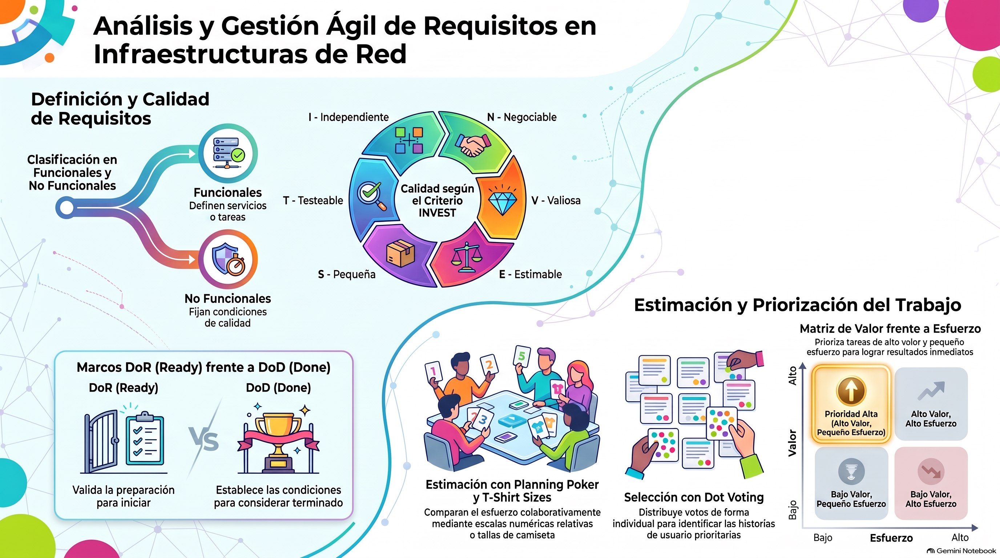

# Análisis de requisitos para el módulo de ASIR del proyecto PI2

## 1. Introducción

Este documento presenta una propuesta de análisis de requisitos para el módulo de **Administración de Sistemas Informáticos en Red (ASIR)** del **Proyecto Intermodular II (PI2)**. Sigue los conceptos de la sesión sobre análisis de requisitos e historias de usuario y los aplica a un proyecto de infraestructura de redes.

El alcance concreto de la infraestructura deberá acordarse con el equipo y las personas interesadas. Por ello, las necesidades y ejemplos de este documento son una base de trabajo que se podrá revisar cuando se conozcan el entorno, las restricciones y los objetivos definitivos.

{width=100%}

## 2. ¿Qué es un requisito?

Un **requisito** expresa algo que el sistema debe hacer o una característica que debe tener. Describe una necesidad que el proyecto debe satisfacer y permite orientar el diseño, la implementación y las pruebas.

Los requisitos se suelen clasificar en:

- **Funcionales:** describen servicios, tareas o comportamientos que la solución debe proporcionar. Por ejemplo, permitir que los equipos de dos departamentos se comuniquen a través de una política de red definida.
- **No funcionales:** describen condiciones de calidad o restricciones de la solución, como seguridad, disponibilidad, rendimiento, capacidad de crecimiento, facilidad de mantenimiento o documentación.

Los requisitos pueden documentarse como enunciados o como **historias de usuario**. Una historia resume una necesidad desde el punto de vista de quien obtiene el beneficio:

> Como `<tipo de usuario>`, quiero `<acción o capacidad>` para `<beneficio>`.

Las historias deben ser comprensibles, negociables, estimables y verificables. El acrónimo **INVEST** recuerda que conviene que sean independientes, negociables, valiosas, estimables, pequeñas y testeables.

## 3. ¿Qué realizará el proyecto de infraestructura de redes?

El proyecto de ASIR analizará, diseñará, desplegará y verificará una infraestructura de red que responda a las necesidades acordadas para el PI2. La solución puede incluir, según el alcance final:

1. **Análisis del entorno y de las necesidades:** identificar usuarios, equipos, servicios, restricciones y riesgos; documentar los requisitos y las decisiones pendientes.
2. **Diseño lógico y físico:** representar la topología, los segmentos de red, los direccionamientos y las conexiones necesarias.
3. **Configuración de la conectividad:** preparar los equipos y servicios de red necesarios, por ejemplo, conmutación, encaminamiento, asignación de direcciones o resolución de nombres, cuando formen parte del alcance.
4. **Seguridad y administración:** proponer controles de acceso y segmentación, proteger la administración de los dispositivos y definir cómo se supervisará y mantendrá la infraestructura.
5. **Pruebas y documentación:** comprobar conectividad y funcionamiento, registrar resultados e incidencias, y entregar diagramas, inventario y procedimientos de operación y recuperación.

El objetivo no es solamente que los dispositivos estén conectados: la infraestructura debe cumplir las necesidades acordadas, ser segura y administrable, y poder verificarse mediante pruebas.

## 4. Historias de usuario y requisitos de ejemplo

Los siguientes ejemplos son candidatos iniciales; no implican que una tecnología concreta o todos los servicios enumerados estén ya aprobados.

| ID | Historia de usuario | Tipo |
|:---|:--------|:----|
| ASIR-01 | Como administrador de sistemas, quiero disponer de un esquema de la topología y del direccionamiento para comprender y mantener la infraestructura. | Funcional |
| ASIR-02 | Como responsable de red, quiero separar los segmentos de usuarios y servicios mediante las medidas de segmentación acordadas para limitar comunicaciones no autorizadas. | Funcional |
| ASIR-03 | Como administrador, quiero verificar la conectividad entre los equipos y servicios incluidos en el alcance para confirmar que la red satisface los casos de uso definidos. | Funcional |
| ASIR-04 | Como responsable de seguridad, quiero que el acceso de administración a los dispositivos esté restringido a los perfiles autorizados para reducir el riesgo de cambios no aprobados. | Funcional y de seguridad |
| ASIR-05 | Como equipo de mantenimiento, quiero recibir documentación de configuración, inventario y procedimientos para poder operar y recuperar la infraestructura. | Funcional |
| ASIR-06 | Como usuario de la infraestructura, quiero que la red cumpla los objetivos de disponibilidad y rendimiento acordados para poder utilizar los servicios previstos. | No funcional |

Los valores concretos de disponibilidad, rendimiento, retención de registros o recuperación deben acordarse antes de considerar cerrados esos requisitos. No se deben inventar umbrales: cuando sean necesarios, el equipo debe definirlos y expresarlos de forma medible.

## 5. Criterios de aceptación

Los **criterios de aceptación** son condiciones claras, observables y comprobables que una historia debe cumplir para que la persona interesada pueda aceptarla. Evitan interpretaciones ambiguas y sirven para diseñar pruebas.

Ejemplo para **ASIR-03**:

- Se ejecutan las pruebas de conectividad acordadas entre los equipos y servicios incluidos en el alcance.
- Cada prueba registra origen, destino, resultado esperado y resultado obtenido.
- Las comunicaciones que deban estar permitidas funcionan según la matriz de conectividad aprobada.
- Las comunicaciones que deban estar bloqueadas no se establecen y el resultado queda documentado.
- Los fallos detectados se registran como incidencias; la historia no se da por aceptada si queda sin resolver un fallo que impida satisfacer los criterios.

Los criterios deben reflejar el alcance aprobado. Por ejemplo, si todavía no se ha decidido qué segmentos pueden comunicarse, esa matriz es una decisión pendiente y no un criterio que se pueda probar correctamente.

### Definition of Ready y Definition of Done

- **Definition of Ready (DoR, definición de preparado):** conjunto compartido de condiciones que una historia debe cumplir antes de incorporarla a una planificación. Su propósito es que el equipo entienda qué necesidad va a resolver y pueda empezar a trabajar sin depender de decisiones esenciales todavía pendientes. Una historia puede considerarse preparada cuando:
  - expresa quién necesita algo, qué necesita y para qué;
  - tiene un alcance comprensible, sin mezclar varios objetivos independientes;
  - incluye criterios de aceptación observables y las decisiones necesarias para verificarlos;
  - identifica dependencias, restricciones, riesgos y recursos o entornos necesarios;
  - tiene dudas importantes resueltas o registradas y, si procede, una estimación inicial.

  La DoR es una ayuda para conversar y detectar trabajo de análisis pendiente, no una autorización para retrasar indefinidamente una historia ni una lista burocrática que haya que rellenar sin criterio. Por ejemplo, antes de planificar la segmentación de la red, el equipo debería conocer qué áreas se separan, qué comunicaciones deben permitirse y qué equipos se usarán para probarlas. Si falta acordar esa matriz de comunicaciones, la historia aún necesita preparación.

- **Definition of Done (DoD, definición de terminado):** conjunto compartido de condiciones de calidad que se aplica al trabajo para poder afirmar que está completo y listo para su entrega o revisión. En este proyecto puede incluir:
  - configuración aplicada en el entorno acordado y coherente con el diseño aprobado;
  - pruebas pertinentes ejecutadas con resultados satisfactorios y evidencias registradas;
  - controles de seguridad y accesos revisados según el alcance;
  - diagramas, inventario y procedimientos afectados actualizados;
  - cambios revisados por otra persona del equipo y sin incidencias conocidas que impidan cumplir los criterios de aceptación.

  La DoD debe ser concreta y común al equipo, y puede adaptarse cuando cambien las necesidades de calidad del proyecto. Por ejemplo, una historia de conectividad no está terminada solo porque un equipo responda a una prueba: también deben comprobarse los casos acordados, registrar sus resultados y actualizar la documentación relacionada.

La DoR determina si se puede empezar a trabajar con suficiente claridad; la DoD establece qué significa haber terminado. Ninguna de las dos sustituye a los criterios de aceptación específicos de cada historia.

## 6. Técnicas de estimación y priorización

Las estimaciones son relativas: ayudan al equipo a comparar trabajo y planificar, pero no garantizan una duración exacta. Se deben realizar de forma colaborativa, teniendo en cuenta esfuerzo, complejidad, incertidumbre y dependencias.

### Planning Poker

Planning Poker es una técnica colaborativa para estimar el tamaño relativo de las historias, sobre todo en esfuerzo, complejidad, incertidumbre y trabajo asociado. No convierte los puntos en horas ni promete una duración concreta. Antes de empezar, el equipo acuerda el significado de la escala y elige una historia conocida como referencia para comparar las demás. Puede utilizar una secuencia creciente, por ejemplo **1, 2, 3, 5, 8 y 13**: cuanto mayor es el valor, mayor suele ser el trabajo o la incertidumbre. Si una historia parece superar el límite acordado —por ejemplo, 13— conviene investigarla o dividirla en historias más pequeñas.

Una ronda habitual se desarrolla así:

1. El equipo lee la historia y sus criterios de aceptación; quien la propone aclara el objetivo y responde preguntas.
2. Cada persona elige en privado una tarjeta o valor, de acuerdo con la escala, y todos muestran la estimación a la vez. La votación simultánea reduce la influencia de la primera cifra que se diga.
3. Si las estimaciones coinciden o son próximas, el equipo comprueba que comparte los mismos supuestos y registra el valor acordado.
4. Si hay diferencias grandes, quienes han estimado más alto y más bajo explican qué trabajo, riesgo o dependencia han tenido en cuenta. Tras aclarar los supuestos, se realiza otra ronda.

El objetivo no es promediar los números ni forzar una unanimidad artificial: es compartir el entendimiento del trabajo. Si siguen existiendo dudas, se puede registrar un intervalo, anotar la incertidumbre o crear una tarea de investigación antes de volver a estimar.

**Ejemplo:** para segmentar la red, una persona puede considerar que basta con configurar una VLAN conocida, mientras otra detecta que faltan definir reglas de comunicación y validar equipos. La conversación permite aclarar el alcance antes de cerrar la estimación.

### T-shirt sizes

T-shirt sizes clasifica historias en tallas relativas, como **XS, S, M, L y XL**, en lugar de asignarles puntos desde el principio. Es útil para una primera revisión de muchas necesidades, cuando se busca distinguir rápidamente su tamaño aproximado o aún hay incertidumbre. La talla puede considerar conjuntamente esfuerzo, complejidad, dependencias y riesgo; no equivale a una cantidad fija de horas ni sirve para comparar equipos con escalas diferentes.

Para que la clasificación sea consistente, el equipo acuerda qué significa cada talla con ejemplos de referencia. Por ejemplo, **XS** puede ser un cambio pequeño y conocido; **S**, una tarea acotada con pocas dependencias; **M**, trabajo que requiere coordinación o varias comprobaciones; **L**, una historia con varias partes, dependencias o incertidumbre; y **XL**, algo demasiado grande o poco claro para planificar como una sola unidad. Las tallas sirven para comparar las historias entre sí, no para afirmar que todas las tareas M durarán lo mismo.

El equipo puede clasificar cada historia en una conversación breve y anotar las razones de los desacuerdos. Si una historia resulta XL, conviene dividirla por resultados valiosos o realizar primero una investigación que reduzca la incertidumbre; no basta con dejarle una talla grande y posponer su análisis. Una vez aclarado el alcance, se puede estimar con mayor detalle usando Planning Poker.

**Ejemplo orientativo:** actualizar un diagrama conocido podría ser S; diseñar y probar la segmentación de varias áreas podría ser L. La talla depende del alcance y la experiencia del equipo, no es una medida universal de horas.

### Dot Voting

Dot Voting (votación por puntos) es una técnica sencilla para hacer visibles las preferencias del grupo cuando hay varias opciones que priorizar, por ejemplo, necesidades, historias o temas que deben debatirse primero. El equipo acuerda las opciones, explica brevemente cada una y entrega a cada participante el mismo número limitado de votos. Cada persona coloca sus votos en las opciones que considera más importantes; puede concentrarlos en una opción o repartirlos, según las reglas acordadas. Después se cuentan los votos y se conversa sobre el resultado.

La votación ayuda a ordenar una conversación y a detectar acuerdos o diferencias, pero no sustituye la decisión responsable del equipo. Los votos reflejan preferencias, no demuestran por sí solos el valor real, el coste ni la viabilidad de una tarea. Antes de fijar el orden final, también hay que considerar requisitos obligatorios, dependencias, riesgos y esfuerzo; además, un empate o una opción con pocos votos puede requerir más debate.

**Ejemplo:** el equipo puede votar entre documentar la topología, preparar la segmentación o configurar la supervisión para identificar qué aporta más valor al primer incremento. Después se estiman las historias seleccionadas mediante Planning Poker o tallas. Los votos ayudan a visualizar preferencias, pero la decisión final debe considerar también dependencias, riesgos y requisitos obligatorios.

## 7. Priorización y revisión

La prioridad debe considerar el valor para las personas usuarias, el esfuerzo, las dependencias y el riesgo. Una matriz de **valor frente a esfuerzo** puede servir como apoyo: las historias de alto valor y bajo esfuerzo suelen ser buenas candidatas iniciales; las de alto valor y mayor esfuerzo pueden planificarse por partes; las de bajo valor se pueden posponer, salvo que sean necesarias por seguridad, cumplimiento o dependencia técnica.

Ejemplos orientativos de tareas de **valor alto y esfuerzo pequeño**, que podrían recibir prioridad alta si no tienen dependencias pendientes:

| Ejemplo de tarea | Valor | Esfuerzo | Prioridad | Motivo |
|:---|:-|:-|:-|:--------|
| Actualizar el diagrama de red con los equipos y conexiones ya conocidos. | Alto | Pequeño | Alta | Facilita que todo el equipo comprenda la infraestructura y ayuda a detectar errores de diseño. |
| Documentar el plan de direccionamiento IP existente y validado. | Alto | Pequeño | Alta | Evita conflictos de direcciones y permite configurar los equipos de forma coherente. |
| Comprobar y registrar la conectividad entre dos equipos de una misma red. | Alto | Pequeño | Alta | Valida rápidamente una función básica y proporciona evidencia útil para el diagnóstico. |

La valoración de estos ejemplos puede cambiar según el alcance real, el riesgo y las dependencias del proyecto; el equipo debe revisarla antes de planificar el trabajo.

Los requisitos e historias deben revisarse con el equipo y las personas interesadas. Si cambia el alcance o aparece información nueva, se actualizan las historias, los criterios de aceptación, las prioridades y las estimaciones afectadas.

## 8. Bibliografía recomendada

- Cohn, Mike. *User Stories Applied: For Agile Software Development*. Addison-Wesley, 2004. Referencia práctica para redactar, organizar y trabajar con historias de usuario.
- International Institute of Business Analysis (IIBA). *A Guide to the Business Analysis Body of Knowledge (BABOK Guide)*. Referencia sobre análisis de necesidades, requisitos y colaboración con las partes interesadas.
- Schwaber, Ken y Sutherland, Jeff. *La Guía Scrum*. Guía oficial de Scrum, disponible en [scrumguides.org](https://scrumguides.org/). Útil para entender el trabajo iterativo y la planificación colaborativa.
- Project Management Institute (PMI). *Agile Practice Guide*. PMI, 2017. Introducción a enfoques ágiles, planificación adaptativa y priorización.
- IEEE. *IEEE Std 29148-2018: Systems and software engineering — Life cycle processes — Requirements engineering*. Estándar para la ingeniería y especificación de requisitos.
- Material docente de Proyecto Intermodular II. *Sesión 3 - Análisis de requisitos. Historias de usuario*, proporcionado en `s3-requisitos.pdf`.
