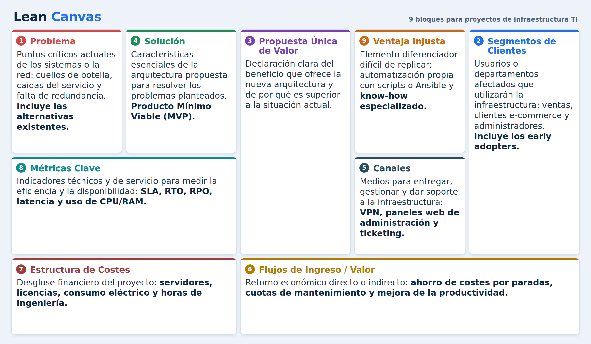

# Guía Práctica: Lean Canvas Aplicado a Proyectos de Infraestructura TI (ASIR)

## Introducción

En el ámbito de la **Administración de Sistemas Informáticos en Red (ASIR)**, los proyectos técnicos no solo deben ser viables desde el punto de vista tecnológico, sino también operativos y ajustados a necesidades reales. El modelo **Lean Canvas**, popularizado por Ash Maurya, permite estructurar, validar e iterar proyectos de infraestructura antes de realizar inversiones significativas en hardware o servicios Cloud.

---

## 1. ¿Qué elementos consta el Lean Canvas?

El Lean Canvas sustituye los extensos planes de negocio por un esquema visual de 9 bloques enfocados en la resolución de problemas y la aportación de valor:

1. **Problema**: Identificación de los puntos críticos actuales en los sistemas o la red (ej. cuellos de botella, caídas del servicio, falta de redundancia). Incluye las *Alternativas Existentes*.
2. **Segmentos de Clientes**: Usuarios o departamentos afectados que utilizarán la infraestructura (ej. departamento de ventas, clientes e-commerce, administradores). Incluye los *Early Adopters*.
3. **Propuesta Única de Valor**: Declaración clara que explica qué beneficio ofrece la nueva arquitectura y por qué es superior a la situación actual.
4. **Solución**: Características esenciales de la arquitectura propuesta para resolver los problemas planteados (Producto Mínimo Viable - MVP).
5. **Canales**: Medios a través de los cuales se entrega, gestiona y da soporte a la infraestructura (VPN, paneles web de administración, ticketing).
6. **Flujos de Ingreso / Valor**: Retorno económico directos o indirectos (ahorro de costes por paradas, cuotas de mantenimiento, mejora en productividad).
7. **Estructura de Costes**: Desglose financiero del proyecto (servidores, licencias, consumo eléctrico, horas de ingeniería).
8. **Métricas Clave**: Indicadores técnicos y de servicio para medir la eficiencia y disponibilidad (SLA, RTO, RPO, latencia, uso de CPU/RAM).
9. **Ventaja Injusta**: Elemento diferenciador difícil de replicar (automatización propia mediante scripts/Ansible, know-how especializado).

*Figura 1. Los 9 bloques del Lean Canvas con el contenido que debe incluir cada uno.*

## 2. Herramientas Gráficas para Elaborar el Esquema

Para desarrollar y presentar el Lean Canvas e integrarlo con la documentación de infraestructura se recomiendan las siguientes herramientas:

| Categoria | Herramientas Recomendadas | Uso Principal |
| :--- | :--- | :--- |
| **Diseño del Canvas** | Miro, Mural, Excalidraw, Canva | Elaboración colaborativa en lienzo infinito y notas adhesivas. |
| **Topología de Red** | Draw.io (Diagrams.net), Cisco Packet Tracer, GNS3 | Representación de diagramas de red, VLANs, servidores y direccionamiento IP. |
| **Documentación Técnico-Económica** | Markdown, Git/GitHub, LaTeX | Control de versiones de la documentación y scripts de infraestructura como código (IaC). |

---

## 3. Metodología de Elaboración (Paso a Paso)

1. **Definir el Escenario e Infraestructura Actual**: Analizar las deficiencias (falta de backups, alta latencia, costes elevados en Cloud).
2. **Formular la Propuesta de Valor**: Traducir mejoras técnicas en beneficios operativos (ej. *"Disponibilidad del 99.9% y recuperación ante desastres en menos de 15 minutos"*).
3. **Diseñar el MVP Técnico**: Construir un entorno de pruebas virtualizado (VirtualBox, Proxmox o vagrant) que valide la solución propuesta.
4. **Calcular Costes y Métricas**: Estimar el gasto en hardware, servicios de terceros y definir los KPI de rendimiento.

---

## 4. Ejemplos Prácticos de Infraestructura para ASIR

### Ejemplo 1: Migración a Nube Híbrida y Alta Disponibilidad
* **Problema**: Servidor único en local con fallos de hardware frecuentes y caídas de servicio.
* **Solución**: Despliegue de clúster con 2 nodos locales y réplica de copias en nube AWS S3.
* **Propuesta de Valor**: Continuidad del negocio sin pérdida de datos frente a fallos físicos.
* **Métricas Clave**: RTO < 30 minutos, RPO < 5 minutos.
* **Estructura de Costes**: 2 Servidores NAS/SAN, almacenamiento AWS S3, licencia VPN.

### Ejemplo 2: Implantación de Infraestructura Zero-Trust y Monitorización Centralizada
* **Problema**: Desconocimiento del estado de los equipos de red y accesos no autorizados a la red interna.
* **Solución**: Autenticación RADIUS, segmentación de VLANs y monitorización con Zabbix y Grafana.
* **Propuesta de Valor**: Visibilidad total del tráfico en tiempo real y aislamiento automático de amenazas.
* **Métricas Clave**: Tiempo de detección de caídas < 1 minuto, alertamiento automático.
* **Estructura de Costes**: Servidor dedicado a monitorización, horas de configuración de switches gestionables.

---

## Conclusión

El uso de Lean Canvas en proyectos de **Administración de Sistemas Informáticos en Red** permite al estudiante o profesional justificar técnicamente y económicamente cada decisión de arquitectura, conectando las necesidades del entorno con la solución tecnológica propuesta.