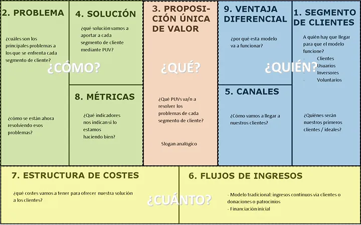
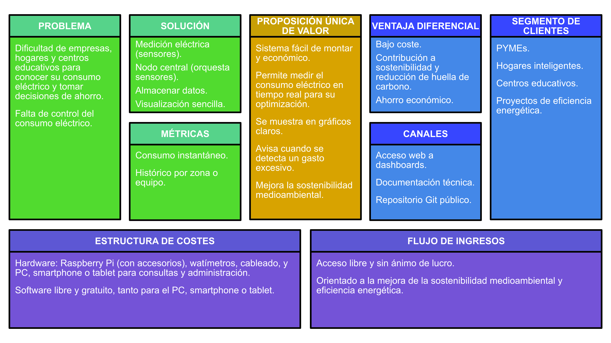

# Módulo PI2. Entregable 1. Proyecto Inicial

**Por:** Paco Aldarias

**Fecha:** Octubre 2026

---

## Instrucciones de la Tarea 1: Presentación del Proyecto Inicial

Para esta primera tarea, vamos a compartir nuestro proyecto inicial para recibir feedback.

Por favor, seguid estos pasos:

1. Cread un nuevo hilo de debate en este foro.
   - **Asunto del hilo:** `[Nombre de vuestro Proyecto]`

2. En vuestra publicación, debéis incluir:
   - 📄 **Resumen del proyecto:** Una descripción breve y clara de vuestra idea.
   - 🖼️ **Imagen del Lean Canvas:** Insertad una imagen legible de vuestro Lean Canvas completo.
   - ▶️ **Enlace a un vídeo explicativo:** Un enlace a vuestra presentación del Lean Canvas.

### Requisitos del Vídeo

- **Contenido:** Explicación clara de cada uno de los bloques de vuestro Lean Canvas.
- **Duración máxima:** 5 minutos.
- **Alojamiento:** El vídeo debe estar subido a vuestro OneDrive corporativo. **Importante:** comprobad que el enlace es público o accesible para que todos podamos verlo.

### Evaluación y Siguientes Pasos

La evaluación de esta tarea se compone de dos partes:

1. **Feedback de compañeros (Opcional pero calificable):**
   - Se valorará vuestra participación activa en el foro. Debéis comentar en los hilos de, al menos, dos compañeros, aportando ideas y sugerencias constructivas.

2. **Calificación del profesor:**
   - Cada proyecto será calificado como **APTO** o **NO APTO**.
   - Si un proyecto es calificado como **NO APTO**, deberéis revisarlo aplicando las sugerencias de mejora que os proporcionaré. El objetivo es trabajar juntos hasta que la propuesta sea sólida y reciba el APTO.

### Requisitos y Temática del Proyecto

- 💡 **Temática Libre:** Podéis elegir un tema que os apasione y os motive. ¡Queremos ver vuestra creatividad en acción!
- 📋 **Condiciones:** Aunque la temática sea libre, el proyecto debe cumplir con una serie de requisitos indicados en la [Guía Conceptual](https://aules.edu.gva.es/ed/mod/url/view.php?id=430790).
- 👥 **Límite por temática:** Se limitará el número de proyectos con ideas muy similares. Si varios proponéis un concepto parecido, deberéis justificar claramente qué diferencia vuestra propuesta y cuál es su valor único.

---

## Estructura que debe seguir un Lean Canvas

Tiene que estar basado en el contexto de tu proyecto. Hay que aportar un documento con el contexto y explicación de la tecnología que vas a usar y los motivos por los cuales has pensado en eso y un vídeo explicando todos los puntos del lean canvas y subirlo a [esta tarea](https://aules.edu.gva.es/ed/mod/assign/view.php?id=425868).

Ten en cuenta que solo con los RA's mínimos, el proyecto puede ser un no apto, tiene que ser innovador y aplicar todos los conocimientos y/o tecnologías que se te ocurran, no solo coger la base.

---

## Ejemplo 1: Raspberry Pi con IoT

### Sistema de Monitoreo IoT de Consumo Eléctrico con Raspberry Pi

Mi idea para el proyecto consiste en diseñar e implementar un sistema de monitoreo del consumo eléctrico. Para ello se usará una Raspberry Pi como nodo central. Los datos de consumo se obtendrán por medio de sensores (watímetros, simulados en el proyecto) y se enviarán mediante protocolos IoT (MQTT o HTTP) a una base de datos MySQL. Habrá una visualización en paneles interactivos con Grafana, para poder analizar el consumo en tiempo real, generar históricos y configurar alertas.

La solución está pensada para ser aplicable en un entorno empresarial, hogares inteligentes o centros educativos. Además de un ahorro económico que puede darse con la optimización de recursos energéticos, contribuye a la sostenibilidad, ya que, al identificar y minimizar consumos excesivos, se puede reducir la huella de carbono.

### Lean Canvas

### GitHub

<https://github.com/Ger-0101/Sistema-monitoreo-iot-consumo-electrico>

### Vídeo de presentación del Lean Canvas

[Ver vídeo de presentación del Lean Canvas](<https://gvaedu-my.sharepoint.com/:v:/g/personal/germarzah_alu_edu_gva_es/Eei7firSNp9LvZEGoQoDzHYBjYY7konLcGNho6TU3tu4EQ?nav=eyJyZWZlcnJhbEluZm8iOnsicmVmZXJyYWxBcHAiOiJPbmVEcml2ZUZvckJ1c2luZXNzIiwicmVmZXJyYWxBcHBQbGF0Zm9ybSI6IldlYiIsInJlZmVycmFsTW9kZSI6InZpZXciLCJyZWZlcnJhbFZpZXciOiJNeUZpbGVzTGlua0NvcHkifX0&e=e7jilb>)
